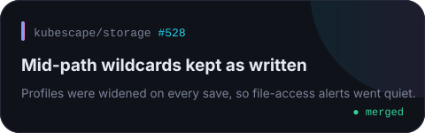
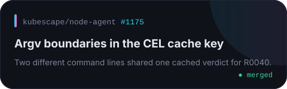
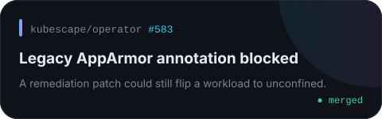
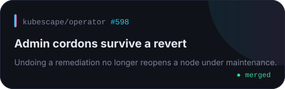

<!-- Cards in assets/ are generated by scripts/build_profile.py and refreshed daily by .github/workflows/profile.yml -->

<picture>
  <source media="(prefers-color-scheme: light)" srcset="assets/hero-light.svg" />
  
</picture>

  
  
  

<picture>
  <source media="(prefers-color-scheme: light)" srcset="assets/neofetch-light.svg" />
  
</picture>

<picture>
  <source media="(prefers-color-scheme: light)" srcset="assets/div-open-light.svg" />
  
</picture>

  <a href="https://github.com/kubescape/storage/pull/528"><picture><source media="(prefers-color-scheme: light)" srcset="assets/fix1-light.svg" /></picture></a>
  <a href="https://github.com/kubescape/node-agent/pull/1175"><picture><source media="(prefers-color-scheme: light)" srcset="assets/fix2-light.svg" /></picture></a>
  <a href="https://github.com/kubescape/operator/pull/583"><picture><source media="(prefers-color-scheme: light)" srcset="assets/fix3-light.svg" /></picture></a>
  <a href="https://github.com/kubescape/operator/pull/598"><picture><source media="(prefers-color-scheme: light)" srcset="assets/fix4-light.svg" /></picture></a>

  <a href="https://github.com/search?q=author%3Aitsvishalyadav+org%3Akubescape+is%3Apr+is%3Amerged&type=pullrequests">all Kubescape PRs →</a>
  &nbsp;·&nbsp;
  <a href="https://github.com/search?q=author%3Aitsvishalyadav+org%3Akyverno+is%3Apr+is%3Amerged&type=pullrequests">all Kyverno PRs →</a>

<picture>
  <source media="(prefers-color-scheme: light)" srcset="assets/div-stack-light.svg" />
  
</picture>

  

<picture>
  <source media="(prefers-color-scheme: light)" srcset="assets/div-activity-light.svg" />
  
</picture>

<picture>
  <source media="(prefers-color-scheme: light)" srcset="https://github-readme-activity-graph.vercel.app/graph?username=itsvishalyadav&bg_color=f6f7fb&color=5b6478&line=7c3aed&point=db2777&area=true&area_color=a78bfa&hide_border=true&radius=16&hide_title=true" />
  
</picture>

<picture>
  <source media="(prefers-color-scheme: light)" srcset="https://raw.githubusercontent.com/itsvishalyadav/itsvishalyadav/output/github-snake.svg" />
  
</picture>
