<!-- Panels in assets/ are drawn by scripts/build_profile.py and refreshed daily by .github/workflows/profile.yml -->

<picture>
  <source media="(prefers-color-scheme: light)" srcset="assets/masthead-light.svg" />
  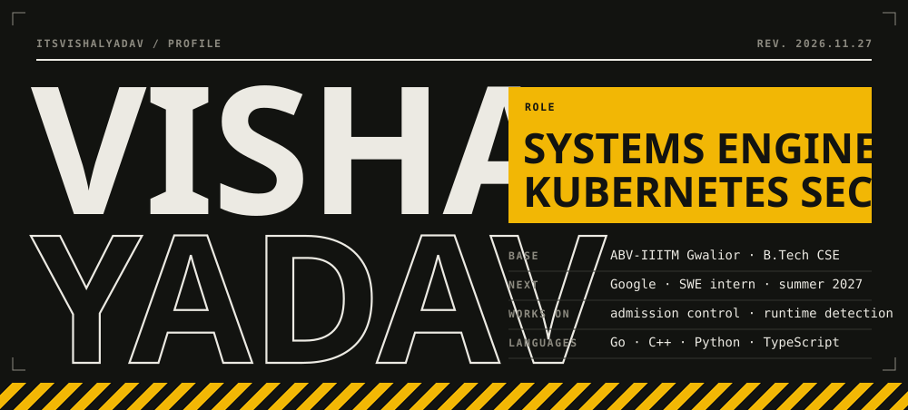
</picture>

  
  
  

<picture>
  <source media="(prefers-color-scheme: light)" srcset="assets/about-light.svg" />
  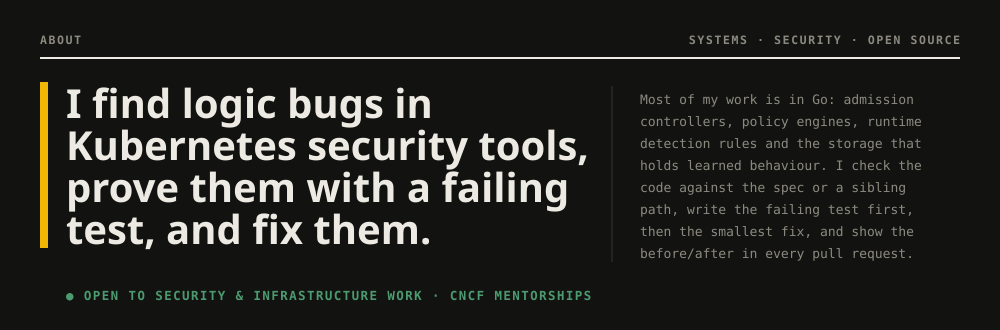
</picture>

<a href="https://github.com/search?q=author%3Aitsvishalyadav+org%3Akubescape+is%3Apr+is%3Amerged&type=pullrequests">
<picture>
  <source media="(prefers-color-scheme: light)" srcset="assets/ledger-light.svg" />
  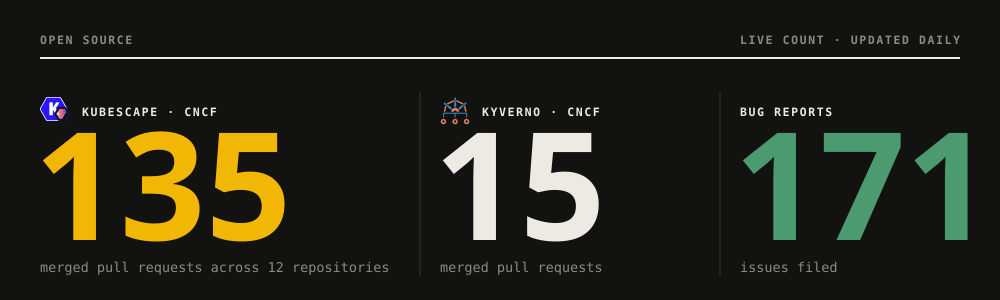
</picture>
</a>

<picture>
  <source media="(prefers-color-scheme: light)" srcset="assets/ticker-light.svg" />
  
</picture>

<picture>
  <source media="(prefers-color-scheme: light)" srcset="assets/repos-light.svg" />
  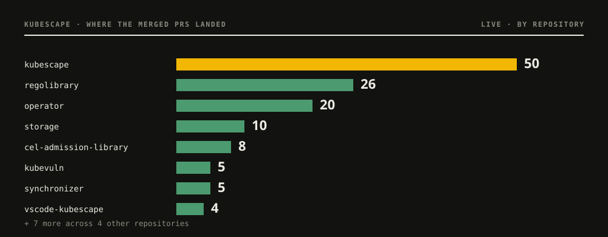
</picture>

<picture>
  <source media="(prefers-color-scheme: light)" srcset="assets/section-work-light.svg" />
  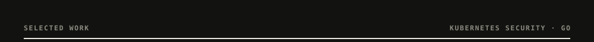
</picture>
<a href="https://github.com/kubescape/storage/pull/528"><picture><source media="(prefers-color-scheme: light)" srcset="assets/work1-light.svg" />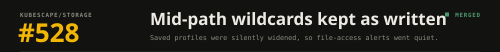</picture></a>
<a href="https://github.com/kubescape/node-agent/pull/1175"><picture><source media="(prefers-color-scheme: light)" srcset="assets/work2-light.svg" />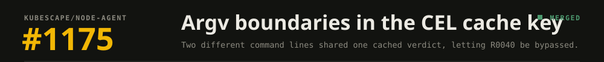</picture></a>
<a href="https://github.com/kubescape/operator/pull/583"><picture><source media="(prefers-color-scheme: light)" srcset="assets/work3-light.svg" />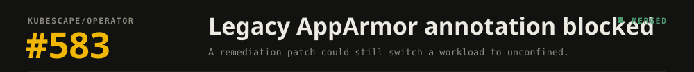</picture></a>
<a href="https://github.com/kubescape/storage/pull/533"><picture><source media="(prefers-color-scheme: light)" srcset="assets/work4-light.svg" />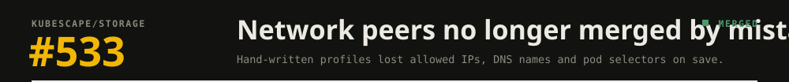</picture></a>

<a href="https://github.com/search?q=author%3Aitsvishalyadav+org%3Akyverno+is%3Apr+is%3Amerged&type=pullrequests">
<picture>
  <source media="(prefers-color-scheme: light)" srcset="assets/kyverno-light.svg" />
  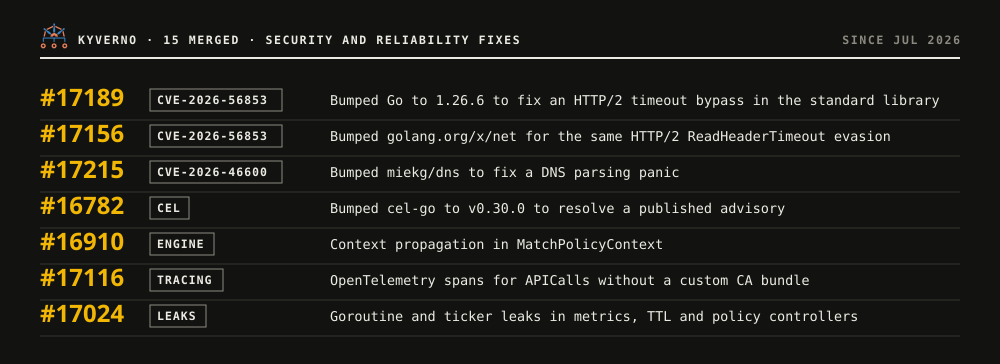
</picture>
</a>

<picture>
  <source media="(prefers-color-scheme: light)" srcset="assets/timeline-light.svg" />
  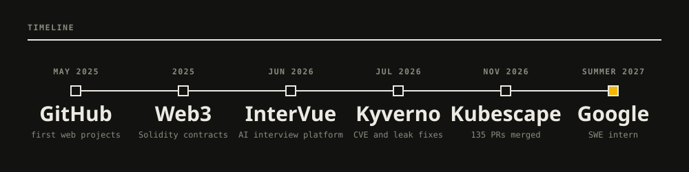
</picture>

<picture>
  <source media="(prefers-color-scheme: light)" srcset="assets/section-built-light.svg" />
  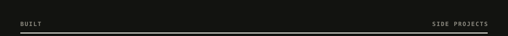
</picture>
<a href="https://github.com/itsvishalyadav/InterVue"><picture><source media="(prefers-color-scheme: light)" srcset="assets/project1-light.svg" />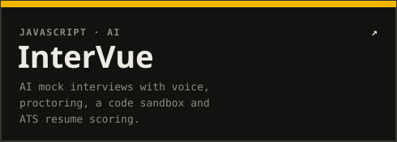</picture></a>
<a href="https://github.com/itsvishalyadav/GetMySeat"><picture><source media="(prefers-color-scheme: light)" srcset="assets/project2-light.svg" />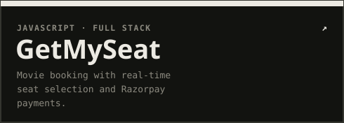</picture></a>
<a href="https://github.com/itsvishalyadav/ai-decision-auditor"><picture><source media="(prefers-color-scheme: light)" srcset="assets/project3-light.svg" />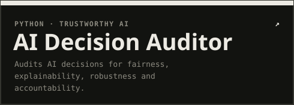</picture></a>
<a href="https://github.com/itsvishalyadav/Foundry-Fund-Me"><picture><source media="(prefers-color-scheme: light)" srcset="assets/project4-light.svg" />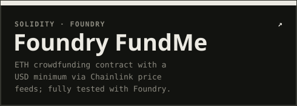</picture></a>

<picture>
  <source media="(prefers-color-scheme: light)" srcset="assets/toolbox-light.svg" />
  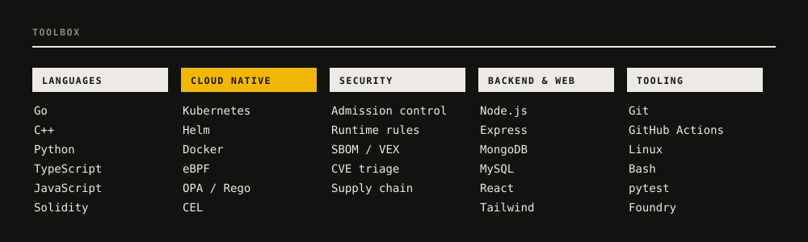
</picture>

<picture>
  <source media="(prefers-color-scheme: light)" srcset="assets/heatmap-light.svg" />
  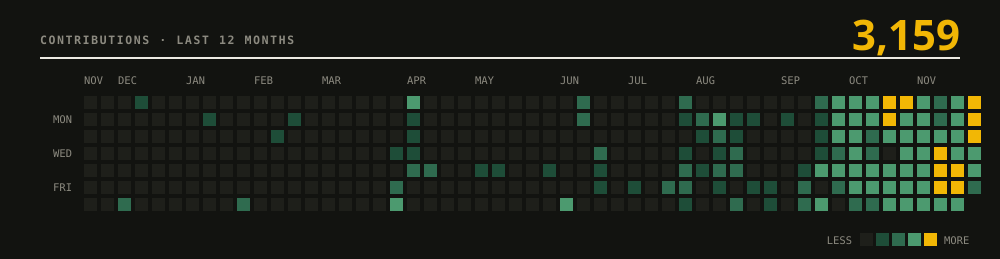
</picture>

<picture>
  <source media="(prefers-color-scheme: light)" srcset="assets/footer-light.svg" />
  
</picture>
